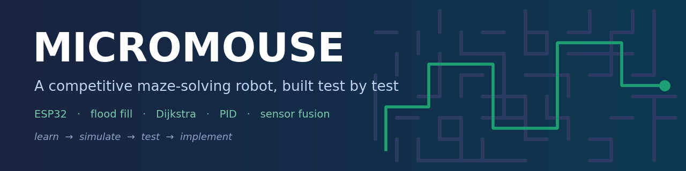
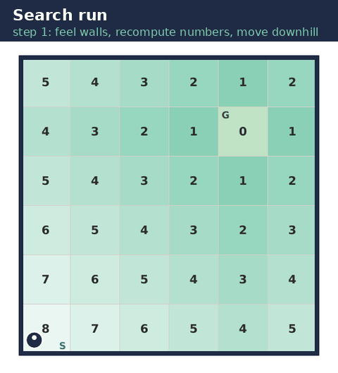
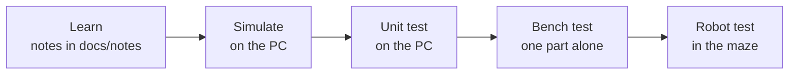
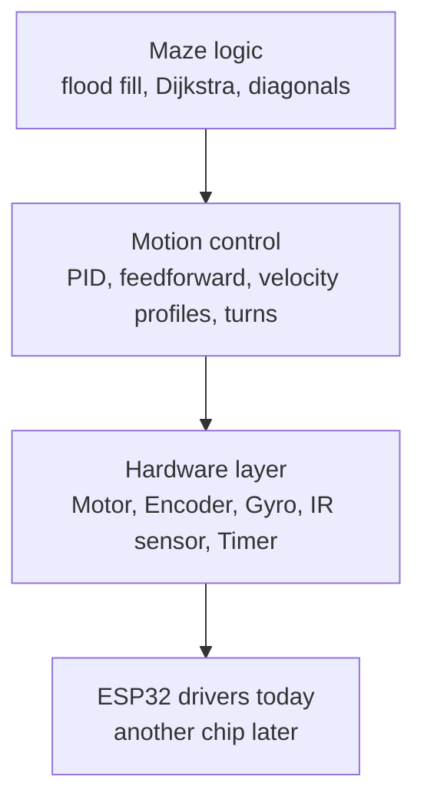
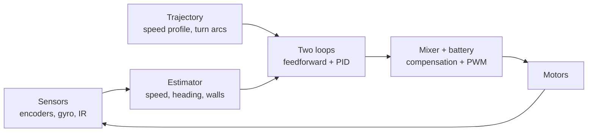

<div align="center">



<br>


**A micromouse built the careful way: every part is learned, simulated and tested on its own before it goes on the robot.**

</div>

---

## The robot in action (simulation)

<div align="center">

</div>

The numbers on the cells are the **flood-fill distances** to the goal. The mouse always steps to a smaller number. When it feels a new wall (red), the numbers are recomputed. Then it returns to the start and runs the best path it learned.

## How this project is built



Nothing goes on the robot until it has passed its own test. The full list of steps, each with a **Pass when** condition, is in the [**roadmap**](docs/roadmap.md).

## Status

| Phase | What | State |
|---|---|---|
| A | Algorithms and control, on the PC | Maze library and unit tests done; Dijkstra, diagonals and control next |
| B | ESP32 alone (timer, PWM, ADC, pulse counter) | Waiting for the ESP32 |
| C | Parts one at a time (motors, encoders, gyro, IR) | Board decision pending |
| D | The maze: search, return, speed run, tuning | Not started |

## Quick start

You only need a C++17 compiler (`g++` or `clang++`). No robot required.

```bash
git clone https://github.com/YOUR-USERNAME/micromouse-esp32.git
cd micromouse-esp32
./run_tests.sh
```

Expected output: six `PASS` lines and `All tests passed`.

To watch it solve mazes, use the [mms simulator](https://github.com/mackorone/mms) with [`simulation/mms/main.cpp`](simulation/mms/main.cpp) (steps in [`simulation/README.md`](simulation/README.md)).

## Architecture

Only the bottom layer touches hardware, so the maze and control code is the same on a PC, in the simulator and on the robot. Changing the chip later means rewriting one layer.



The control loop runs at **1 kHz** from a hardware timer:



## Target specifications

*These are design targets, not measured results.*

| | |
|---|---|
| Brain | ESP32 |
| Maze | 16 × 16 cells, 180 mm each, centre 2 × 2 goal |
| Control loop | 1 kHz timer interrupt, 20 kHz motor PWM |
| Drive | 2 × N20 gearmotor with encoders, TB6612FNG or DRV8833 driver |
| Sensing | 4 IR wall sensors (ambient-light cancelled), gyro, wheel encoders |
| Algorithms | Flood fill search, Dijkstra speed-run planner, diagonals, curved turns |
| Power | 2S LiPo (7.4 V) with battery compensation |
| Budget | about ₹5,000 |

## Repository layout

```text
micromouse-esp32/
├── README.md
├── run_tests.sh              runs every unit test on your PC
├── firmware/
│   └── lib/maze/maze.h       portable maze logic (no hardware calls)
├── tests/                    unit tests for the portable code
├── simulation/
│   └── mms/main.cpp          flood fill for the mms simulator
├── hardware/                 board decision log and draft pin maps (unverified)
└── docs/
    ├── roadmap.md            every milestone with its pass test
    ├── devlog/               one entry per work session
    ├── notes/                study notes (Word documents)
    └── images/
```

## Study notes

Written while learning, one document per part. Each topic has an explanation, simulation figures and a table of every term.

| Part | Document |
|---|---|
| 3. Maze algorithms | [Micromouse_Maze_Algorithms.docx](docs/notes/Micromouse_Maze_Algorithms.docx) |
| 4. Motion and control theory | [Micromouse_Motion_and_Control.docx](docs/notes/Micromouse_Motion_and_Control.docx) |
| 5. Sensors | [Micromouse_Sensors.docx](docs/notes/Micromouse_Sensors.docx) |
| 6. Electronics | [Micromouse_Electronics.docx](docs/notes/Micromouse_Electronics.docx) |

## Devlog

Short entries after each work session: [docs/devlog](docs/devlog/README.md).

## Acknowledgements

- [UKMARS](https://ukmars.org/) (UK Micromouse and Robotics Society) and Peter Harrison for the open UKMARSBOT design and their documentation.
- [mms](https://github.com/mackorone/mms), the maze simulator.

## License

[MIT](LICENSE). Replace `YOUR NAME` in the license file with your own.
