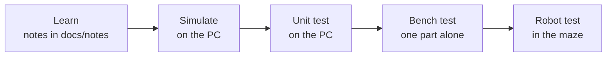

# Roadmap: one tested step at a time

The rule for this project: **learn it, simulate it, unit-test it, bench-test it, and only then put it on the robot.**
Nothing is added to the robot that has not already passed a test on its own.

Every milestone below has a **Pass when** line. A milestone is only ticked when that line is true.

## Phase A: on the PC (no hardware)

- [ ] **M0. Repo and notes.** Repo created, notes written (maze algorithms, motion and control, sensors, electronics). *(Tick this once the repo is pushed to GitHub.)*
  *Pass when:* the repo is on GitHub and `./run_tests.sh` runs.
- [ ] **M1. Flood fill in the simulator.** Code is written (Python, then C++ in [`simulation/mms`](../simulation/mms)). *(Tick this after you have run it in mms.)*
  *Pass when:* the mouse reaches the centre of a test maze and the numbers on the cells update as walls are found.
- [x] **M2. Portable maze library with unit tests.** [`firmware/lib/maze/maze.h`](../firmware/lib/maze/maze.h) and [`tests/test_maze.cpp`](../tests/test_maze.cpp).
  *Pass when:* `./run_tests.sh` prints `All tests passed`.
- [ ] **M3. Run in mms.** Return run and second run on several standard mazes.
  *Pass when:* it finishes every maze without hitting a wall, and the second run is not longer than the first.
- [ ] **M4. Dijkstra with turn costs.** State is `(x, y, heading)`. Unit tests first.
  *Pass when:* on a test maze it chooses a route with a lower time cost than flood fill, and on a maze where both agree it gives the same route.
- [ ] **M5. Diagonal path conversion.** Straights, 45-degree turns, diagonal runs.
  *Pass when:* converted paths cover the same cells in the same order, and the total length is never longer than the staircase.
- [ ] **M6. Simulated motor control.** PID, feedforward and velocity profile against a simulated motor, with plots.
  *Pass when:* the simulated speed reaches the target with no steady error, anti-windup keeps the overshoot small, and the profile stops exactly at the target distance.
- [ ] **M7. Simulated sensing.** Odometry, gyro bias calibration and the complementary filter on simulated data.
  *Pass when:* the fused heading error is smaller than the gyro-only error and the reference-only error in a test run.

## Phase B: on the ESP32 alone (no robot)

- [ ] **M8. Blink and serial.** Toolchain works, a program uploads and prints.
  *Pass when:* an LED blinks and numbers appear on the serial monitor.
- [ ] **M9. 1 kHz timer.** A hardware timer interrupt runs the control loop.
  *Pass when:* measured loop jitter stays small over 60 seconds and the loop never overruns its 1 ms slot.
- [ ] **M10. PWM and ADC.** 20 kHz PWM on a pin; ADC read with averaging.
  *Pass when:* the PWM frequency measures about 20 kHz (scope or logic analyser), and averaging reduces the ADC noise.
- [ ] **M11. Pulse counter.** Count a known signal from another pin.
  *Pass when:* the count matches the number of pulses generated, in both directions.
- [ ] **M12. PID on the ESP32.** Run the PID class against a simulated motor in code.
  *Pass when:* the ESP32 gives the same response as the PC simulation (M6).

## Phase C: parts, one at a time

- [ ] **M13. Board decision and build.** See [`hardware/`](../hardware). Bring-up checklist, no motors connected.
  *Pass when:* the 3.3 V rail is correct and the ESP32 runs the blink program on the new board.
- [ ] **M14. Motor and driver.** Wheels off the ground, low duty.
  *Pass when:* both motors turn the right way and speed follows duty.
- [ ] **M15. Encoders.** Counts to distance.
  *Pass when:* rolling the mouse 500 mm by hand reads 500 mm within 2%.
- [ ] **M16. Battery measurement.** Voltage divider and ADC.
  *Pass when:* the reading matches a multimeter within 0.1 V.
- [ ] **M17. Gyro.** Read, calibrate bias, integrate heading.
  *Pass when:* a 90-degree hand turn reads 90 degrees within 2, and standing still the heading drifts by less than a set limit.
- [ ] **M18. IR wall sensors.** Ambient subtraction, calibration.
  *Pass when:* wall present or absent is detected correctly at the cell centre, in light and in shade.
- [ ] **M19. Straight driving and turns.** Speed loop, heading hold, 90-degree turns.
  *Pass when:* it drives 1 metre straight and ends within a set error, and four 90-degree turns bring it back to its heading.
- [ ] **M20. Wall centering.** Steering from the IR sensors.
  *Pass when:* it drives down a corridor from an off-centre start and settles in the middle.

## Phase D: the maze

- [ ] **M21. Search run in a real maze** (a small test maze first).
- [ ] **M22. Return run, then speed run.**
- [ ] **M23. Tune and speed up:** acceleration, turn speed, then curved turns and diagonals.

## Notes behind each phase

| Topic | Notes document |
|---|---|
| Algorithms (M1 to M5) | [Maze Algorithms](notes/Micromouse_Maze_Algorithms.docx) |
| Motion and control (M6, M12, M19, M20) | [Motion and Control](notes/Micromouse_Motion_and_Control.docx) |
| Sensors (M7, M11, M15, M17, M18) | [Sensors](notes/Micromouse_Sensors.docx) |
| Electronics (M10, M13, M14, M16) | [Electronics](notes/Micromouse_Electronics.docx) |
